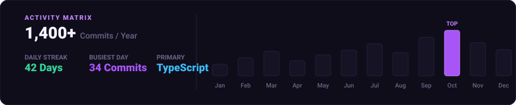
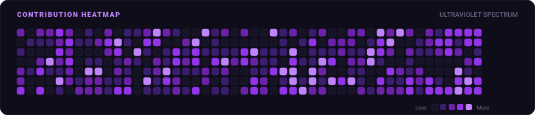

  <!-- Hero Card: Name, Violet Sweep Shine, Status Badge & Animated Terminal ASCII -->
  

 

  <!-- 3 World Tiles in a Row (32.5% width each) -->
  
  
  

 

  <!-- Activity Matrix: Streak, Busiest Day & Monthly Activity Chart -->
  

 

  <!-- Ultraviolet Contribution Heatmap -->
  

 

  All cards are rendered dynamically as animated SVGs via GitHub Actions. Crafted in Deep Obsidian &amp; Electric Violet.

